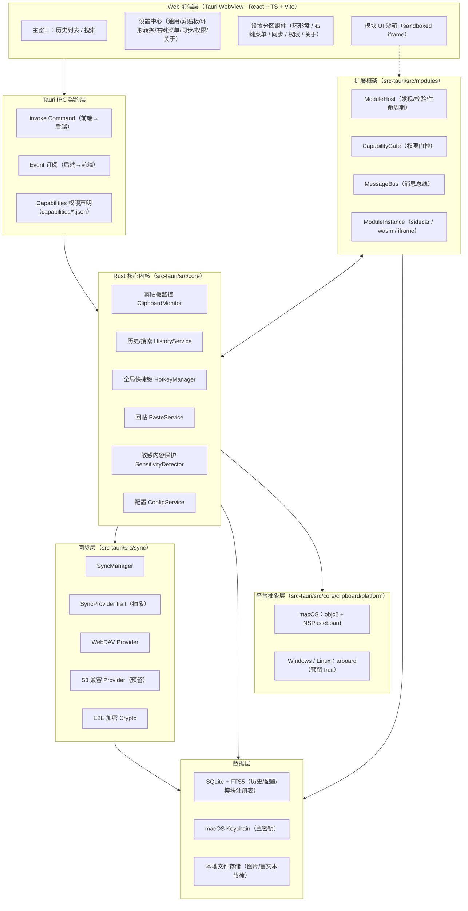
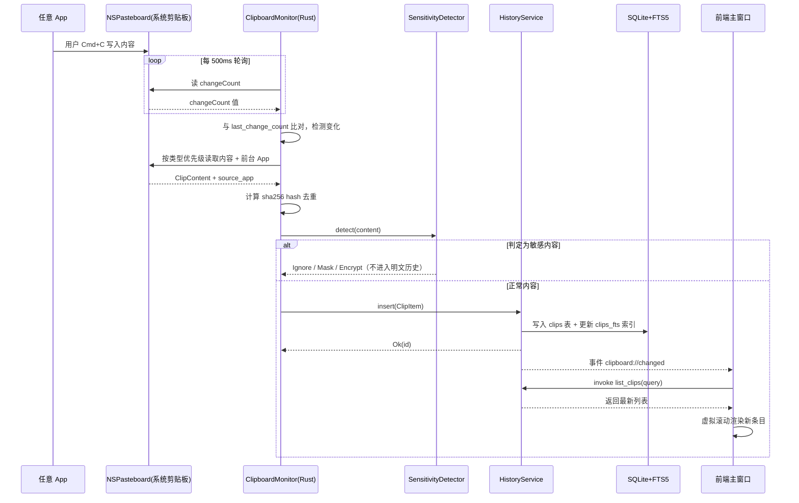
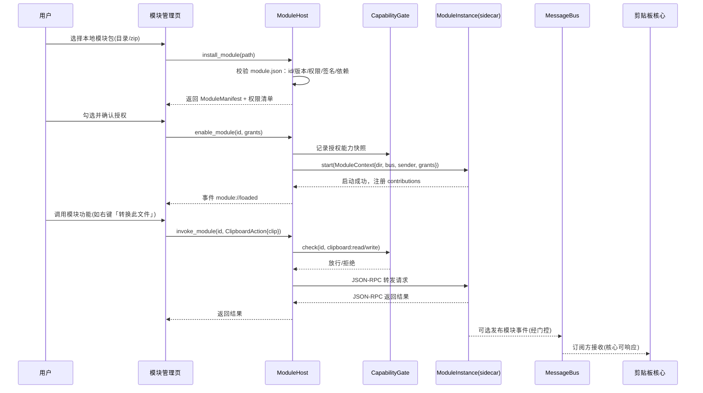
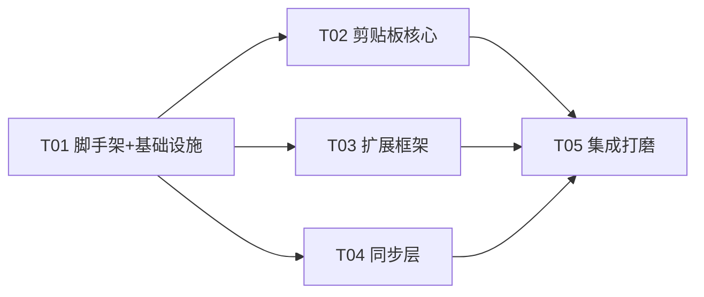

# ClipBase 系统架构设计 + 任务分解

> 文档版本：v1.0（架构部分仍有效；§7 目录树已于 2026-10-26 按实际代码更新）
> 架构师：高见远
> 上游输入：`docs/PRD.md`（P0 需求 + 扩展性架构底线）
> 技术栈锁定：**Tauri 2（Rust 后端 + Web 前端）**，**macOS 优先**，架构预留 Windows/Linux，**开源**（MIT / Apache-2.0 待拍板）
>
> **阅读提示**：本文是设计稿。实际实现差异、已知问题与运行方式以
> `docs/IMPLEMENTATION.md` 为准；**环形转换（含文件类型 Profile、唯一手势、
> 单面环与禁用项）以 `docs/REA-Filee-Ring-Integrated.md` 为总规范**，该文档
> 取代了早期的逆向记录 `docs/REA-Filee-Ring-Wheel.md`（正背面/滚轮已下线）与
> `docs/REA-iCopy-Filee.md`（旧版配置模型）。
> §8 的 T01–T05 任务分解是历史排期记录（已全部完成），其中提到的
> `Modules.tsx` / `ModuleCard.tsx` 等页面已随主窗口「只做设置中心」的改造移除。

---

## 1. 总体架构

ClipBase 采用 **「Tauri 分层架构 + 模块宿主（Module Host）」** 的总体结构。核心思想：**Rust 后端是可信内核（Core），Web 前端是纯展示层（UI），功能模块是可插拔的「二等公民」**，通过标准化的扩展框架挂载，绝不与核心剪贴板本体耦合。



**分层职责边界：**

| 层 | 职责 | 边界约束 |
| --- | --- | --- |
| Web 前端（UI） | 展示、交互、渲染 | **不直接访问系统能力**；一切经 `invoke`/`Event`；模块 UI 在 iframe 内隔离 |
| Tauri IPC | 数据契约、权限声明 | 所有命令显式声明在 `capabilities` 中；事件命名走统一约定 |
| Rust 核心（Core） | 剪贴板/历史/快捷键/回贴/敏感识别/配置 | 可信内核，可独立演进，**不依赖任何模块** |
| 扩展框架 | 模块生命周期、权限、通信 | 模块与核心**强解耦**，模块崩溃不影响内核 |
| 同步层 | provider 抽象 + 具体实现 + 加密 | 与核心通过 `SyncManager` 松耦合 |
| 数据层 | 持久化 | 核心与模块都只经服务层访问，不直接碰 DB |
| 平台抽象层 | 屏蔽 OS 差异 | macOS 实现现在做，Win/Linux 留 trait 空实现 |

**关键设计决策：**
- **核心永远不 import 模块代码**——依赖方向单向：`模块 → 核心 SDK`，`核心 → 模块` 只通过 `ModuleHost` 的 trait 抽象与 `MessageBus` 事件。
- **模块以「独立进程（sidecar）」或「沙箱 WASM」运行**，UI 以「sandboxed iframe」渲染，天然满足 EXT-03「模块崩溃不影响核心」。

---

## 2. 技术选型与理由

### 2.1 Rust 后端关键 crate

| 领域 | crate | 选型理由 |
| --- | --- | --- |
| 应用框架 | `tauri = "2"`（feature：`image-png`） | 已锁定的技术栈；轻量、内存占用小、可复用系统 WebView |
| 构建 | `tauri-build = "2"` | Tauri 构建脚本 |
| 全局快捷键 | `tauri-plugin-global-shortcut = "2"` | 官方插件，内部封装 `global-hotkey`，跨平台（macOS 用 Carbon/RegisterEventHotKey），与 Tauri 权限体系集成，**优先于自定义实现** |
| 菜单栏图标 | 不使用（已取消 `tray-icon` feature） | 纯后台常驻：入口只有全局快捷键唤起的面板，设置/退出在面板与设置页里（见 IMPLEMENTATION 第 11 章） |
| 剪贴板读写 | `arboard = "3"` | 跨平台（macOS/Windows/Linux）剪贴板读写的事实标准，供 Win/Linux 与通用读写使用 |
| macOS 剪贴板监控 | `objc2 = "0.5"` + `objc2-app-kit = "0.2"` | 通过 `NSPasteboard.generalPasteboard.changeCount` 轮询实现监控（详见 2.4） |
| 键盘模拟（触发粘贴） | `enigo = "0.2"` | 跨平台键盘注入，用于「回贴」时模拟 `Cmd+V`（macOS 需辅助功能权限） |
| 数据库 | `rusqlite`（feature：`bundled`，启用 FTS5） | 内嵌 SQLite，无外部依赖；Rust 侧直接控制 FTS 索引与事务 |
| 迁移 | `rusqlite_migration` | 轻量 schema 版本化管理 |
| HTTP（同步） | `reqwest`（feature：`rustls-tls`、`json`） | WebDAV/S3 客户端；rustls 避免 OpenSSL 系统依赖，便于跨平台构建 |
| 端到端加密 | `chacha20poly1305` + `argon2` | AEAD 对称加密 + 密码派生的 KDF，轻量、审计成熟 |
| 密钥存储 | `keyring` | 主密钥存 macOS Keychain |
| 异步 | `tokio`（`rt-multi-thread`、`macros`、`sync`、`time`） | 同步/轮询等后台任务 |
| 序列化 | `serde` + `serde_json` | 数据契约与同步文件格式 |
| 错误处理 | `thiserror` + `anyhow` | 库内定义错误类型，命令边界统一转 `AppError` |
| 日志 | `tracing` + `tracing-subscriber` | 结构化日志，便于排查 |
| 哈希 | `sha2` | 内容去重（ClipItem.hash） |
| ID | `uuid` | 同步批次/模块实例 ID |
| 数据目录 | `dirs` | 跨平台应用数据目录 |
| 动态加载（P1 预留） | `libloading`（native cdylib）、`wasmtime`（WASM） | 原生/ WASM 模块运行时，见第 4 章，首版可不启用 |

### 2.2 Web 前端框架

**推荐：React 18 + Vite + TypeScript + Zustand + Tailwind CSS**

| 选型 | 理由 |
| --- | --- |
| React 18 | 生态最大，模块 UI（贡献点）、虚拟列表、调试工具最全；团队上手成本最低 |
| Vite | 冷启动快、HMR 快，契合「主窗口瞬时唤起」体验；产物精简 |
| Zustand | 极轻量状态管理（<1KB），替代 Redux 的复杂度，足够管理历史列表/搜索/设置 |
| Tailwind CSS | 快速实现简洁 UI，配合主题切换 |
| `@tanstack/react-virtual` | 历史列表上千条时的虚拟滚动，保证流畅 |
| ~~`fuse.js`~~ | 早期规划的「前端模糊兜底」实际未落地：搜词固定走后端 FTS5，已从依赖中移除 |

> **备选说明**：若团队更看重极致体积，可换 **Svelte**（编译期优化、运行时更小）。但 Svelte 生态与模块 UI 贡献点的复用性弱于 React，故默认推荐 React，最终选择列入「待明确事项」。

### 2.3 数据库选型：SQLite

- **为什么 SQLite**：单机常驻工具，数据量级（万条以内剪贴板记录）完全够用；零部署、可审计、易备份（就是本地一个 `.db` 文件）；FTS5 提供开箱即用的全文搜索。
- **表结构设计思路**（详见第 5 章）：
  - `clips`：历史主表，大文本/图片载荷走外置文件，表中只存元数据 + 短文本。
  - `clips_fts`：FTS5 虚拟表，仅对「文本类可检索内容」建索引，`content='clips'` 外置内容表避免双写。
  - `config`：key-value 配置存储。
  - `modules`：模块注册表（id、版本、状态、授权能力）。
  - `sync_state`：同步游标/版本向量（LWW 冲突处理的 last-write 时间戳）。
- **敏感内容**：密码/token 类默认不入库；可选加密时，加密字段用应用层 AEAD（不依赖 SQLCipher，降低编译复杂度）。

### 2.4 macOS 剪贴板监控与全局快捷键的具体实现方式

#### 剪贴板监控（核心难点）

macOS **没有剪贴板变更通知 API**。业界成熟做法（Maccy、Paste 同款）是 **轮询 `NSPasteboard.changeCount`**：

1. 后台线程每 **500ms**（可调，默认兼顾延迟与省电）读一次 `NSPasteboard.generalPasteboard.changeCount`。
2. 与上一次记录的 `changeCount` 比较，变化即触发读取。
3. 按优先级读取类型：`NSPasteboardTypeString` → `NSPasteboardTypeHTML` → `NSPasteboardTypePNG/TIFF` → `NSFilenamesPboardType`（文件列表）。
4. 读取时记录 `source_app`（前台应用名），供历史条目展示来源。

**实现选择：自定义 Rust 实现（`objc2` + `objc2-app-kit`）**，而非 Tauri 官方剪贴板插件。理由：

| 方案 | 结论 |
| --- | --- |
| `tauri-plugin-clipboard-manager` | 官方插件，但定位是「读写」，**不提供 changeCount 监控能力**，无法满足 CB-01 |
| 自定义 `objc2` 轮询 | 可控、可扩展类型、可拿到 `source_app`，是满足 P0 的唯一可靠路径 |

`arboard` 仍用于**跨平台读写回填**与 Win/Linux 兜底；macOS 的「监控」走 `objc2` 轮询，「写回」可用 `arboard` 或 `objc2` 二者之一（设计上收敛为统一 `ClipboardPort` trait，见 5.4）。

#### 全局快捷键

**选择：`tauri-plugin-global-shortcut`（官方插件）**。理由：官方维护、跨平台、权限声明走 Tauri capabilities、无需手写 macOS Carbon `RegisterEventHotKey`。自定义实现收益低、维护成本高，不推荐。

#### 回贴（触发粘贴）

写入剪贴板后模拟 `Cmd+V`：使用 `enigo` 注入键盘事件。**注意**：macOS 需要「辅助功能（Accessibility）」权限，需在设置页做引导与检测。提供降级：无权限时仅「复制到剪贴板」，用户手动粘贴。

---

## 3. 核心模块设计（P0）

### 3.1 剪贴板监控（CB-01）

- **职责**：监听系统剪贴板变更，捕获文本/富文本/图片/文件类型，稳定不丢内容。
- **关键数据结构**：`ClipContent`、`ClipboardPort` trait（平台抽象）。
- **对外接口**：
  - `ClipboardMonitor::start(&self, tx: mpsc::Sender<ClipEvent>)`
  - `ClipboardMonitor::stop(&self)`
  - `ClipboardMonitor::poll_once() -> Result<Option<ClipContent>>`
- **内部**：维护 `last_change_count`，去重（同一 `changeCount` 不重复处理）；通过 `sha2` 计算内容 hash 用于历史去重。

### 3.2 历史列表（CB-02）

- **职责**：按时间倒序保存历史，数量上限 + 容量上限（默认 2000 条 / 500MB，可调）。
- **关键数据结构**：`ClipItem`、`HistoryQuery`。
- **对外接口**：
  - `insert(item: ClipItem) -> Result<i64>`
  - `query(q: HistoryQuery) -> Result<Vec<ClipItem>>`
  - `get(id) -> Result<ClipItem>`
  - `delete(id)` / `clear()` / `pin(id, bool)` / `favorite(id, bool)`
- **容量策略**：超出上限时按「最旧优先」删除，同时清理外置文件载荷。

### 3.3 搜索（CB-03）

- **职责**：按关键词/类型即时模糊搜索。
- **实现**：SQLite FTS5 对文本做全文检索 + 类型/时间过滤。关键词统一交给后端（`list_clips`），
  前端只做 250ms 防抖 + 序号保护（后发查询优先），不在客户端再跑一轮模糊匹配。
- **对外接口**：`HistoryQuery { keyword: Option<String>, content_type: Option<ContentType>, limit, offset, pinned_only }`

### 3.4 全局快捷键（CB-04）

- **职责**：全局热键调出/收起主窗口，可自定义。
- **默认**：`Cmd+Shift+V` 唤起主窗口；预留「快速回贴」组合键。
- **对外接口**：`HotkeyManager::register(cfg)` / `unregister()` / `set(hotkey, action)`；冲突检测返回 `HotkeyConflict`。

### 3.5 回贴（CB-05）

- **职责**：选中条目写回剪贴板并触发粘贴，支持置顶/固定。
- **对外接口**：`PasteService::paste(id) -> Result<PasteOutcome>`（内部：写回 → `enigo` 模拟 Cmd+V）；`PasteOutcome` 含「已粘贴」/「仅复制（无辅助功能权限）」状态。

### 3.6 敏感内容保护（CB-07，P1 但 P0 架构预留）

- **职责**：识别密码/token 类内容，按策略忽略/脱敏/加密。
- **实现**：`SensitivityDetector::detect(&ClipContent) -> SensitivityResult`（启发式规则 + 常见密码管理器剪贴板标记；预留本地 AI 识别扩展点）。
- **策略枚举**：`Ignore` / `Mask` / `Encrypt`，配置可调，默认 `Ignore`。

---

## 4. 扩展框架设计（重点 · 地基的核心）

> 本节回答：模块如何被定义、注册、发现、加载、卸载；模块与核心如何通信；权限如何声明与隔离；未来「鼠标右键工具」「文件转换(filee)」如何接入；目录结构约定。

### 4.1 模块的三层能力模型（按隔离强度分级）

一个「模块」= **一个目录包**，内含 `module.json` 清单 + 可选 UI 资源 + 可选后端。按后端运行方式分三级：

| 级别 | 运行方式 | 隔离性 | 系统能力 | 适用场景 |
| --- | --- | --- | --- | --- |
| **L0 纯 UI 模块** | sandboxed iframe + postMessage | 强（浏览器沙箱） | 仅经核心授权的受限 API | 简单展示、设置面板、剪贴板动作的纯前端逻辑 |
| **L1 WASM 模块** | `wasmtime` 沙箱 + host functions | 强（内存沙箱） | 受 `CapabilityGate` 控制的宿主函数 | 计算密集、需安全隔离的模块 |
| **L2 原生 sidecar 模块** | 独立子进程 + JSON-RPC over stdio | 强（进程隔离） | 声明式能力，经门控放行 | 文件转换、右键工具等需真实系统调用的模块 |

**首版落地顺序**：**L2 sidecar + L0 iframe UI**（覆盖 filee 文件转换、右键工具等绝大多数场景，隔离最彻底），**L1 WASM 作为 P1** 预留（`wasmtime` 已在依赖清单标注为可选）。

### 4.2 模块清单契约（module.json）

```jsonc
{
  "schema": 1,
  "id": "com.clipbase.filee",           // 全局唯一，反域名格式
  "name": "文件转换",
  "version": "0.1.0",
  "min_core": "0.1.0",                  // 最低核心版本
  "description": "基于 filee 的本地文件转换工具",
  "author": "clipbase-community",
  "runtime": "sidecar",                 // "iframe" | "sidecar" | "wasm"
  "entry": {
    "backend": "bin/filee-cli",         // sidecar 可执行文件（相对模块目录）
    "ui": "index.html"                  // 可选：模块自己的 UI 入口
  },
  "permissions": [                      // 能力声明（白名单）
    "clipboard:read",
    "clipboard:write",
    "fs:read:module",                   // 仅模块自身目录
    "fs:read:user",                     // 用户选定目录（需运行时授权）
    "network:webdav"
  ],
  "contributions": [                    // 统一入口贡献点
    { "type": "tray", "label": "文件转换", "icon": "icon.png" },
    { "type": "clipboard_action", "label": "转换此文件", "mime": ["image/*", "application/pdf"] },
    { "type": "shortcut", "label": "打开文件转换", "default": "Cmd+Shift+F" },
    { "type": "settings", "label": "文件转换设置" }
  ],
  "lifecycle": { "run_on": "demand" }   // "demand"（按需启动）| "background"（常驻）
}
```

### 4.3 核心接口 / 契约（Rust 签名）

```rust
// —— 模块清单（解析 module.json 后的类型）——
pub struct ModuleManifest {
    pub schema: u32,
    pub id: ModuleId,                  // String 包装
    pub name: String,
    pub version: semver::Version,      // 用 semver crate
    pub min_core: semver::Version,
    pub runtime: ModuleRuntime,        // Iframe | Sidecar | Wasm
    pub entry: ModuleEntry,
    pub permissions: Vec<Capability>,
    pub contributions: Vec<Contribution>,
    pub lifecycle: Lifecycle,
}

// —— 能力（权限白名单）——
pub enum Capability {
    ClipboardRead,
    ClipboardWrite,
    FsReadModule,          // 仅模块目录
    FsReadUser,            // 需运行时授权
    FsWriteUser,
    Network,               // 需运行时授权
    // ... 扩展点：新能力在此枚举追加 + CapabilityGate 里实现
}

// —— 贡献点（模块声明接入统一入口的方式）——
pub enum Contribution {
    Tray { label: String, icon: Option<String> },
    ClipboardAction { label: String, mime: Vec<String> },
    Shortcut { label: String, default: String },
    Settings { label: String },
    Command { id: String, label: String },   // 命令面板项
}

// —— 模块宿主：核心暴露给模块侧的稳定 API ——
pub trait ModuleHostApi {
    fn discover(&self) -> Result<Vec<ModuleManifest>>;
    fn install(&self, pkg_path: &Path) -> Result<ModuleManifest>;      // 校验+解包+入库
    fn uninstall(&self, id: &ModuleId) -> Result<()>;
    fn enable(&self, id: &ModuleId, grants: Vec<Capability>) -> Result<()>;
    fn disable(&self, id: &ModuleId) -> Result<()>;
    fn list(&self) -> Result<Vec<ModuleRecord>>;
    fn invoke(&self, id: &ModuleId, msg: ModuleMessage) -> Result<ModuleMessage>;
}

// —— 一个运行中的模块实例（宿主内部持有，非模块实现）——
pub struct ModuleInstance {
    id: ModuleId,
    state: ModuleState,               // Stopped | Starting | Running | Crashed
    handle: InstanceHandle,           // SidecarHandle | WasmInstance | IframeHandle
    grants: Vec<Capability>,          // 用户实际授权的子集
}

// —— 模块上下文：核心启动模块时注入 ——
pub struct ModuleContext {
    pub module_dir: PathBuf,          // 模块自身数据目录（隔离）
    pub bus: MessageBus,              // 只读视图：订阅/发布
    pub sender: ModuleSender,         // 模块 → 核心的受限发送通道
    pub grants: Arc<[Capability]>,    // 本次授权的只读副本
}
```

### 4.4 模块与核心的通信方式

统一走 **消息总线（MessageBus）+ 请求/响应（JSON-RPC）** 双通道：

| 通道 | 方向 | 用途 | 约束 |
| --- | --- | --- | --- |
| **Event（总线广播）** | 核心 → 模块 / 模块 → 核心 | 剪贴板变化、历史更新、同步状态等主题订阅 | 模块只能订阅被授权能力对应的主题 |
| **Request/Response（JSON-RPC）** | 模块 → 核心 | 模块调用核心能力（读剪贴板、读写文件、网络） | 每条请求经 `CapabilityGate` 校验 |
| **invoke（前端）** | UI → 核心 | 前端页面调用 | Tauri 命令，capabilities 声明 |

- **sidecar 模块**：核心以 `tokio::process` 启动子进程，stdin/stdout 走 **JSON-RPC 2.0 over stdio**（每行一个 JSON 消息）。
- **iframe 模块**：核心经 Tauri 事件把「受限 API」注入到 iframe，iframe 内通过 `postMessage` 与父页面（核心 UI）通信。
- **能力门控（CapabilityGate）**：位于 `MessageBus` 与 `ModuleHost` 之间的唯一关口，任何模块请求必须通过 `gate.check(module_id, capability, payload)`，未授权直接拒绝并记日志。

```rust
// JSON-RPC 请求（模块 → 核心）
{ "jsonrpc": "2.0", "id": 1, "method": "clipboard.read", "params": {} }
// 核心应答
{ "jsonrpc": "2.0", "id": 1, "result": { "text": "..." } }
// 或错误
{ "jsonrpc": "2.0", "id": 1, "error": { "code": 403, "message": "capability not granted" } }
```

### 4.5 权限声明、隔离与安全默认值

1. **默认禁用**：模块安装完成后默认 `Disabled`，不加载、不启动任何代码（安全默认）。
2. **最小授权**：用户启用时，`CapabilityGate` 只授予 manifest 声明 ∩ 用户勾选 的能力；敏感能力（`Network`、`FsReadUser`）需额外显式确认。
3. **进程隔离**：L2 sidecar 是独立进程，崩溃/卡死只影响自身；宿主用心跳 + 超时监测，异常时自动 `Crashed` 并通知核心（EXT-03）。
4. **目录隔离**：模块只能读写 `~/.clipbase/modules/<id>/`；访问用户目录必须经 `fs:read:user` 且运行时弹授权。
5. **UI 隔离**：模块 UI 渲染在 `sandbox` iframe（无 `allow-same-origin` 与 Node 权限），杜绝任意代码拿到前端上下文。
6. **审计日志**：所有授权与拒绝事件写入 `tracing` 日志，模块页可查看权限清单。

### 4.6 「鼠标右键工具」「文件转换(filee)」如何接入

它们都是普通模块，接入方式完全一致，关键在于**贡献点**：

| 模块 | 贡献点 | 运行时 | 说明 |
| --- | --- | --- | --- |
| 鼠标右键工具 | `ClipboardAction`（作用于选中条目）+ `Tray` | L2 sidecar | 用户在历史条目右键菜单看到「转换此文件」，调用模块 |
| 文件转换(filee) | `ClipboardAction`（`mime: ["image/*","application/pdf"]`）+ `Shortcut` + `Tray` | L2 sidecar | 从用户本机 filee 源码提取 CLI，按 `bin/filee-cli` 打包进模块 |

**剪贴板动作（ClipboardAction）扩展点契约**：核心在用户右键某条目时，枚举所有「启用的、mime 匹配」的 `ClipboardAction`，动态生成菜单项；点击后核心经 `ModuleHost::invoke(id, ModuleMessage::ClipboardAction { clip })` 把条目内容交给模块，模块处理完可通过 `clipboard:write` 回写结果。

### 4.7 模块目录结构约定

```
~/.clipbase/
├── modules/                       # 已安装模块根
│   └── com.clipbase.filee/
│       ├── module.json            # 清单（必须）
│       ├── bin/filee-cli          # sidecar 可执行文件（runtime=sidecar 时必须）
│       ├── index.html             # 模块 UI 入口（可选）
│       ├── assets/                # 静态资源
│       └── data/                  # 模块私有数据目录（隔离，仅模块可写）
├── data/clipbase.db               # 主数据库
├── data/files/                    # 图片/富文本外置载荷
└── logs/                          # 日志
```

> 开发期用仓库内 `modules.example/` 作为示例模块；打包工具（P1）负责「源码 → 模块包」的标准化。

---

## 5. 数据结构与接口（关键签名）

### 5.1 剪贴板与历史

```rust
#[derive(Clone, Copy, PartialEq, Eq, Serialize, Deserialize)]
pub enum ContentType { Text, Html, Image, Files, Unknown }

#[derive(Clone, Serialize, Deserialize)]
pub enum ClipContent {
    Text(String),
    Html(String),
    Image { path: String, width: u32, height: u32 },
    Files(Vec<String>),
}

#[derive(Clone, Serialize, Deserialize)]
pub struct ClipItem {
    pub id: i64,
    pub content_type: ContentType,
    pub content: ClipContent,
    pub preview: String,            // 截断预览文本
    pub source_app: Option<String>,
    pub created_at: i64,            // unix ms
    pub last_used_at: i64,
    pub pinned: bool,
    pub favorite: bool,
    pub sensitive: bool,
    pub size_bytes: u64,
    pub hash: String,               // sha256，去重
    pub sync_state: SyncState,
}

#[derive(Clone, Serialize, Deserialize)]
pub struct HistoryQuery {
    pub keyword: Option<String>,
    pub content_type: Option<ContentType>,
    pub pinned_only: bool,
    pub limit: u32,
    pub offset: u32,
}
```

### 5.2 配置

```rust
#[derive(Clone, Serialize, Deserialize)]
pub struct Config {
    pub max_items: u32,             // 默认 2000
    pub max_bytes: u64,             // 默认 500MB
    pub monitor_enabled: bool,
    pub poll_interval_ms: u64,      // 默认 500
    pub sensitivity: SensitivityPolicy,   // Ignore | Mask | Encrypt
    pub hotkeys: HotkeyConfig,
    pub sync: SyncConfig,
}

#[derive(Clone, Serialize, Deserialize)]
pub struct SyncConfig {
    pub enabled: bool,              // 默认 false（本地优先）
    pub provider: SyncProviderKind, // WebDav | S3（预留）
    pub credentials: SyncCredentials,
    pub encryption: bool,           // E2E 加密开关
}
```

### 5.3 同步 provider trait

```rust
#[async_trait]
pub trait SyncProvider: Send + Sync {
    fn kind(&self) -> SyncProviderKind;
    async fn test(&self, creds: &SyncCredentials) -> Result<(), SyncError>;
    async fn push(&self, snapshot: &SyncSnapshot) -> Result<(), SyncError>;
    async fn pull(&self, since: &SyncCursor) -> Result<SyncSnapshot, SyncError>;
}

// 同步快照：序列化为 JSON 文件，整体加密后上传
pub struct SyncSnapshot {
    pub items: Vec<ClipItem>,
    pub cursor: SyncCursor,         // 版本向量 / last-write 时间戳
    pub updated_at: i64,
}
```

### 5.4 平台抽象（剪贴板端口）

```rust
pub trait ClipboardPort: Send + Sync {
    fn read(&self) -> Result<ClipContent, ClipError>;
    fn write(&self, content: &ClipContent) -> Result<(), ClipError>;
    /// macOS 返回 NSPasteboard.changeCount；Win/Linux 返回自增计数器
    fn change_count(&self) -> Result<u64, ClipError>;
    fn frontmost_app(&self) -> Option<String>;
}
```

### 5.5 模块接口（已在第 4 章定义，此处汇总）

`ModuleHostApi` trait、`ModuleManifest`、`Capability`、`Contribution`、`ModuleContext` —— 见 4.3。

### 5.6 统一错误类型

```rust
#[derive(Debug, Serialize)]
pub struct AppError { pub code: i32, pub message: String, pub details: Option<String> }
// 所有 Tauri 命令统一返回 Result<T, AppError>，前端据此展示
```

**前端一侧必须注意**：命令失败时 `invoke` 的 Promise reject 的是上面这个对象经
`serde_json::to_value` 序列化后的 JSON（`{ code, message, details }`），**不是字符串**。
直接 `String(e)` 会得到 `"[object Object]"`，`e instanceof Error` 也是 false。
因此 `src/lib/ipc.ts` 在 `invoke` 外层统一折成 `ApiError`（见 `src/lib/errors.ts`）：
`message` 是可读文案（`message：details`），`toString()` 返回同一句，`code` 保留原值。
新增命令一律走 `api.*`，不要在业务代码里直接 `import { invoke }`。

---

## 6. 调用流程

### 6.1 复制 → 监控 → 入库 → 展示（主流程）



### 6.2 模块安装/启用 → 调用



---

## 7. 文件列表（项目结构树）

> 采用 Tauri 2 标准布局：`src/` 为 Web 前端，`src-tauri/` 为 Rust 后端。
> 本树已按 2026-10-26 的实际代码校对，**不要照抄历史设计稿里的页面名**。

```
clipbase/
├── package.json / vite.config.ts / tsconfig.json
├── tailwind.config.ts / postcss.config.js / index.html
├── README.md / LICENSE
├── docs/                               # 文档（见下方说明）
│   ├── PRD.md                          # 产品需求
│   ├── ARCHITECTURE.md                 # 本文
│   ├── IMPLEMENTATION.md               # 实际实现、差异点、坑（以它为准）
│   ├── UI-DESIGN.md                    # 苹果风格设计规范
│   ├── module-spec.md                  # 模块开发规范
│   ├── REA-Filee-Conversion.md         # 格式转换逆向规范（当前实现依据）
│   ├── REA-Filee-Ring-Wheel.md         # 环形盘逆向规范
│   ├── REA-Filee-Ring-Editor.md        # 环形编辑页逆向规范
│   ├── REA-iCopy-Filee.md              # iCopy / Filee 逆向分析报告
│   ├── class-diagram.mermaid           # 数据模型类图
│   ├── sequence-diagram.mermaid        # 捕获→入库→展示时序图
│   └── screenshots/                    # 面板实拍 + filee/（逆向证据图）
├── src/                                # ===== Web 前端（React）=====
│   ├── main.tsx                        # React 挂载入口
│   ├── App.tsx                         # 根组件：按窗口 label 分发
│   ├── index.css                       # Tailwind 主题与动效
│   ├── lib/
│   │   ├── ipc.ts                      # invoke 封装（命令 + 类型安全）
│   │   ├── types.ts                    # 与 Rust 契约对齐的 TS 类型
│   │   ├── events.ts                   # 事件名常量
│   │   ├── ringGeometry.ts             # 环形盘几何/命中/标签锚点（运行与预览共用）
│   │   ├── dialog.ts / toast.ts        # 自绘对话框与轻提示（WKWebView 不实现 window.confirm）
│   │   └── filters.ts / format.ts / sanitize.ts / windows.ts / version.ts
│   ├── store/
│   │   ├── useClipStore.ts             # 历史/搜索/配置/同步状态
│   │   └── useReplyStore.ts            # 快捷回复数据
│   ├── windows/
│   │   ├── Panel.tsx                   # 剪贴板面板（快捷键唤出的贴底横条）
│   │   ├── MainWindow.tsx              # 设置中心外壳（侧边栏）
│   │   ├── ReplyPicker.tsx             # 快捷回复选择器（独立现场窗口）
│   │   └── RingWindow.tsx              # Finder 环形转换盘
│   ├── pages/
│   │   ├── HistoryPage.tsx             # 高级历史管理（从面板进入）
│   │   ├── RingSettings.tsx            # 设置 → 环形转换（环形编辑 + 预设配方）
│   │   ├── Modules.tsx                 # 设置 → 模块（安装/授权启用/停用/卸载）
│   │   └── Settings.tsx                # 设置 → 通用/剪贴板/右键菜单/模块/同步/权限/关于
│   ├── hooks/useClipActions.ts         # 条目共享交互（面板/历史页复用）
│   └── components/
│       ├── ui.tsx                      # 共享控件库（Btn/Segment/Pill/Switch/…）
│       ├── RingEditor.tsx              # 环形编排视图（拖入/排序/移除/翻面）
│       ├── ClipItem.tsx / ClipDetail.tsx / ClipContextMenu.tsx
│       ├── TagBar.tsx / VirtualList.tsx / StatusBar.tsx
│       ├── SyncSettings.tsx / ContextMenuSettings.tsx
│       └── DialogHost.tsx / ToastHost.tsx / FirstRunGuide.tsx / PermissionCenter.tsx
├── src-tauri/                          # ===== Rust 后端 =====
│   ├── Cargo.toml                      # Rust 依赖与 feature
│   ├── tauri.conf.json                 # Tauri 应用配置（窗口/插件/安全策略）
│   ├── capabilities/default.json       # 前端 capabilities 权限声明
│   ├── finder-extension/               # Finder Sync 扩展（Swift，独立构建）
│   ├── icons/                          # 应用图标
│   ├── Info.plist / entitlements.plist # Finder 服务与签权声明
│   ├── build.rs                        # Tauri 构建脚本
│   └── src/
│       ├── main.rs                     # 进程入口
│       ├── lib.rs                      # Tauri Builder：注册插件/命令/状态（无菜单栏图标）
│       ├── state.rs                    # AppState（各服务实例，Tauri State）
│       ├── error.rs / events.rs        # AppError / 事件名常量
│       ├── window.rs                   # 面板/主窗口/环形窗口的定位与层级
│       ├── menu.rs                     # 应用菜单（App/编辑/显示/窗口）
│       ├── alert.rs / secrets.rs       # 提醒 / 密钥存储
│       ├── import.rs                   # iCopy 迁移入库（配合 bin/clipbase_import.rs）
│       ├── bin/clipbase_import.rs      # 迁移 CLI
│       ├── config/
│       │   ├── mod.rs                  # ConfigService：读/写/patch/迁移
│       │   └── settings.rs             # Config / RingConfig / ConversionConfig + migrate()
│       ├── storage/
│       │   ├── mod.rs / db.rs          # rusqlite 连接与初始化
│       │   ├── migrations.rs           # 版本化迁移
│       │   └── schema.rs               # 表结构常量
│       ├── core/
│       │   ├── clipboard/              # monitor + types + platform/{macos,windows,linux}
│       │   ├── history/{mod,search}.rs # 历史 CRUD + FTS5 搜索
│       │   ├── hotkey/ paste/ sensitivity/ sound.rs
│       │   ├── stack/mod.rs            # 剪贴板堆栈（锁定回贴）
│       │   ├── reply/{mod,xlsx}.rs     # 快捷回复与 xlsx 导入导出
│       │   ├── convert/                # 格式转换（§8 预设→Job→路由）
│       │   │   ├── mod.rs              # 入口：detect / adhoc_preset / convert_file
│       │   │   ├── format.rs           # ConvertFormat（图片/文档）
│       │   │   ├── preset.rs           # 预设配方 + 内置预设 + 迁移映射
│       │   │   ├── edge.rs             # 引擎边 / EdgeMode / ConvertError
│       │   │   ├── engines/            # image / text / document + 门面
│       │   │   ├── router.rs           # Dijkstra 路由（≤3 步，Terminal 只能收尾）
│       │   │   ├── output.rs           # 预留→临时文件→原子提交
│       │   │   ├── job.rs              # Job / 逐文件结果 / 并发与取消
│       │   │   └── text.rs             # md/html/txt 互转纯函数
│       │   ├── ring/mod.rs             # Finder 环形转换会话状态机
│       │   ├── finder/{mod,macos}.rs   # Finder 选中项读取与状态
│       │   ├── services/{mod,macos,bridge}.rs   # Finder 右键服务桥接
│       │   ├── desktop_menu/{mod,macos}.rs      # 右键菜单（原生）
│       │   ├── option_tap/mod.rs       # Option+拖动手势旁听
│       │   └── appicon/mod.rs          # 应用图标获取
│       ├── modules/                    # 扩展框架（manifest/capabilities/host/sidecar/bus/wasm）
│       ├── sync/                       # provider / webdav / crypto / manager
│       ├── qa_tests/                   # 跨模块回归测试
│       └── commands/                   # clipboard / config / convert / ring / reply
│                                       # stack / services / sync / modules / system
└── modules.example/
    └── filee/                          # 示例模块（演示目录结构约定，非构建依赖）
        ├── module.json
        ├── bin/filee-cli               # 占位脚本
        └── index.html                  # 示例 UI
```

---

## 8. 任务列表（CRITICAL · 按实现顺序）

> 拆分为 **5 个任务**，首个任务为「项目脚手架 + 基础设施」。T02/T03/T04 在 T01 完成后可并行推进，T05 依赖前三者完成。
>
> **注意**：下表的「涉及文件」是当时的计划稿，含已不存在的页面名（`History.tsx`、
> `SearchBar.tsx`、`SettingsPanel.tsx`、`Modules.tsx`、`ModuleCard.tsx`、`commands/history.rs`）。
> 五个任务均已完成，真实文件清单只看 §7 目录树。

| 任务 | 名称 | 涉及文件 | 依赖 | 验收标准 |
| --- | --- | --- | --- | --- |
| **T01** | 项目脚手架 + 基础设施 | `package.json`、`vite.config.ts`、`tsconfig.json`、`tailwind.config.ts`、`postcss.config.js`、`index.html`、`src-tauri/Cargo.toml`、`src-tauri/tauri.conf.json`、`src-tauri/capabilities/default.json`、`src-tauri/build.rs`、`src-tauri/src/main.rs`、`src-tauri/src/lib.rs`、`src-tauri/src/state.rs`、`src-tauri/src/error.rs`、`src-tauri/src/events.rs`、`src-tauri/src/config/{mod.rs,settings.rs}`、`src-tauri/src/storage/{mod.rs,db.rs,migrations.rs,schema.rs}`、`src-tauri/src/commands/mod.rs`、`src/main.tsx`、`src/App.tsx`、`src/lib/{ipc.ts,types.ts,events.ts}`、`src/store/useClipStore.ts` | 无 | ① `pnpm tauri dev` 可启动并显示空窗口；② SQLite 自动建表（clips/clips_fts/config/modules/sync_state）；③ `invoke("get_config")` 返回默认值、前后端契约打通；④ 统一错误类型与事件常量化就位 |
| **T02** | 剪贴板核心 + 前端主窗口 | `src-tauri/src/core/clipboard/{mod.rs,types.rs,platform/mod.rs,platform/macos.rs,platform/windows.rs,platform/linux.rs}`、`src-tauri/src/core/history/{mod.rs,search.rs}`、`src-tauri/src/core/hotkey/mod.rs`、`src-tauri/src/core/paste/mod.rs`、`src-tauri/src/core/sensitivity/mod.rs`、`src-tauri/src/commands/{clipboard.rs,history.rs}`、`src/pages/History.tsx`、`src/components/{SearchBar.tsx,ClipList.tsx,ClipItem.tsx,ClipContextMenu.tsx,StatusBar.tsx}`、`src/lib/events.ts`（扩展） | T01 | ① 复制文本后历史实时新增并展示；② 搜索按关键词/类型即时过滤；③ 全局快捷键 `Cmd+Shift+V` 唤起/收起窗口；④ 选中条目可回贴（无辅助功能权限时降级为仅复制）；⑤ 敏感内容默认不入库；⑥ 容量上限生效 |
| **T03** | 扩展框架（地基 · 最重要） | `src-tauri/src/modules/{mod.rs,manifest.rs,capabilities.rs,host.rs,instance.rs,sidecar.rs,bus.rs,wasm.rs}`、`src-tauri/src/commands/modules.rs`、`src/pages/Modules.tsx`、`src/components/ModuleCard.tsx`、`modules.example/filee/{module.json,bin/filee-cli,index.html}`、`docs/module-spec.md` | T01（建议在 T02 事件/总线稳定后集成贡献点） | ① 可安装/校验/启用/禁用/卸载示例模块；② 模块贡献点（tray/clipboard_action/shortcut）正确出现在统一入口；③ 模块侧进程崩溃不影响核心（心跳监测）；④ 权限清单可见且可授权，未授权能力被 `CapabilityGate` 拒绝；⑤ `module.json` 非法时安装被拒并报清晰错误 |
| **T04** | 同步层 | `src-tauri/src/sync/{mod.rs,provider.rs,webdav.rs,crypto.rs,manager.rs}`、`src-tauri/src/commands/sync.rs`、`src/components/SyncSettings.tsx`、`src/pages/Settings.tsx`（同步 tab） | T01、T02 | ① 配置 WebDAV 后可 push/pull 历史与配置；② 开启 E2E 加密后云端文件为密文（不可读明文）；③ 同步默认关闭、本地优先；④ 多端冲突按 LWW 处理；⑤ provider trait 清晰，S3 可后续无侵入追加 |
| **T05** | 托盘 + 设置 + 集成打磨 | `src-tauri/src/tray/mod.rs`、`src-tauri/src/commands/config.rs`、`src-tauri/src/core/mod.rs`、`src/pages/Settings.tsx`（其余 tab）、`src/components/{SettingsPanel.tsx,HotkeySettings.tsx}`、`src/App.tsx`（整合）、`README.md`、`LICENSE` | T02、T03、T04 | ① 托盘菜单含最近 N 条 + 模块区 + 暂停监控/清空/设置/退出；② 设置面板各 tab（通用/剪贴板/快捷键/同步/模块）可用且持久化；③ 模块贡献点与托盘/快捷键/设置统一集成；④ 核心链路端到端可用、无阻塞 |

### 任务依赖图



---

## 9. 依赖包清单

### 9.1 Rust crates（src-tauri/Cargo.toml）

```toml
[dependencies]
tauri = { version = "2", features = ["image-png"] }
tauri-plugin-global-shortcut = "2"
serde = { version = "1", features = ["derive"] }
serde_json = "1"
tokio = { version = "1", features = ["rt-multi-thread", "macros", "sync", "time", "process", "io-util"] }
rusqlite = { version = "0.32", features = ["bundled"] }   # 需启用 FTS5
rusqlite_migration = "1"
arboard = "3"
enigo = "0.2"
reqwest = { version = "0.12", features = ["rustls-tls", "json"], default-features = false }
chacha20poly1305 = "0.10"
argon2 = "0.5"
keyring = "3"
thiserror = "2"
anyhow = "1"
tracing = "0.1"
tracing-subscriber = { version = "0.3", features = ["env-filter"] }
sha2 = "0.10"
uuid = { version = "1", features = ["v4"] }
dirs = "6"
semver = "1"
async-trait = "0.1"

[target.'cfg(target_os = "macos")'.dependencies]
objc2 = "0.5"
objc2-app-kit = "0.2"

# P1 预留（模块运行时扩展，首版可不启用）
# libloading = "0.8"      # 原生 cdylib 模块
# wasmtime = "27"         # WASM 模块

[build-dependencies]
tauri-build = { version = "2", features = [] }
```

### 9.2 npm 包（package.json）

```
- react@^18.3.0：UI 框架
- react-dom@^18.3.0：DOM 渲染
- typescript@^5.6.0：类型系统
- vite@^6.0.0：构建工具
- @vitejs/plugin-react@^4.3.0：React 插件
- @tauri-apps/api@^2.0.0：Tauri 前端 API（invoke/event）
- @tauri-apps/cli@^2.0.0：Tauri 开发/构建 CLI
- zustand@^5.0.0：轻量状态管理
- tailwindcss@^3.4.0 + postcss@^8 + autoprefixer@^10：样式
- @tanstack/react-virtual@^3.10.0：虚拟滚动
```

---

## 10. 共享知识（跨文件约定）

- **命名规范**：Rust 用 snake_case（模块/函数/变量）、CamelCase（类型/trait/enum）；TS 用 camelCase；文件小写下划线分隔；模块 `id` 用反域名 `com.clipbase.*`。
- **错误处理约定**：库内部用 `thiserror` 定义具体错误；Tauri 命令边界统一转 `AppError { code, message, details }` 返回前端；`code` 采用分类段（`1xxx` 剪贴板、`2xxx` 历史、`3xxx` 同步、`4xxx` 模块）。
- **事件命名约定**：URI 风格 `domain://event`，如 `clipboard://changed`、`history://created`、`sync://status-changed`、`module://loaded`、`module://crashed`；常量集中在 `events.rs` / `lib/events.ts`。
- **数据契约约定**：Rust 与前端通过 `serde` JSON 对齐，`src/lib/types.ts` 与 Rust struct 保持字段/类型一一对应；时间戳统一 **unix 毫秒 (i64)**；所有 ID 为 i64（自增）或字符串（模块 id）。
- **异步约定**：后台长任务（同步、轮询、模块进程）走 `tokio`，Tauri 命令用 `async fn`；UI 状态更新靠事件推送，避免轮询。
- **安全默认值**：同步默认关、模块默认禁用、网络/用户目录能力默认拒、敏感内容默认忽略、不上传遥测。
- **平台抽象约定**：所有 OS 相关能力必须落在 `platform/` 目录的 trait 实现里，核心代码不得出现 `#[cfg(target_os=...)]` 散落。
- **模块契约冻结**：`module.json` 的 `schema` 字段用于版本协商，破坏性变更需 bump schema 并保留兼容解析。

---

## 11. 待明确事项

| # | 待确认项 | 建议 | 影响 |
| --- | --- | --- | --- |
| 1 | 开源协议 | MIT（宽松）或 Apache-2.0（含专利条款） | 仓库 LICENSE 与社区策略 |
| 2 | 前端框架最终确认 | React（推荐）vs Svelte（更轻） | 影响模块 UI 贡献点复用方式 |
| 3 | 模块运行时首版范围 | 建议 L2 sidecar + L0 iframe，WASM 延后 P1 | 扩展框架工作量 |
| 4 | 数据库加密方案 | 建议应用层 AEAD（字段加密），SQLCipher 延后 | 编译复杂度、性能 |
| 5 | 敏感内容默认策略 | 建议默认「忽略」不入库 | 隐私体验 |
| 6 | 历史容量默认值 | 建议 2000 条 / 500MB | 存储与清理策略 |
| 7 | P0 类型范围 | 建议 P0 仅文本 + 富文本，图片/文件延后 P1（架构已预留） | 首版收敛 |
| 8 | 回贴权限提示策略 | macOS 需「辅助功能」权限，需确认引导文案与降级 | 用户体验 |
| 9 | 账号体系 | 建议「免账号 + E2E 加密 + 自选后端」，不建账号 | 后端复杂度 |
| 10 | 模块分发形态 | 建议首版仅「本地加载」，市场/签名延后 P1 | 模块框架范围 |
| 11 | 产品正式命名 | ClipBase / ClipForge / ClipDock | 品牌与仓库名 |

---

*本文档为架构设计与任务分解基线，供工程师（T03/T04 等）直接按序实现。扩展框架（第 4 章）的接口与契约为冻结基线，实现时如遇冲突请先与架构师确认。*
